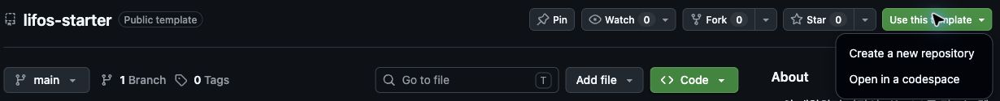
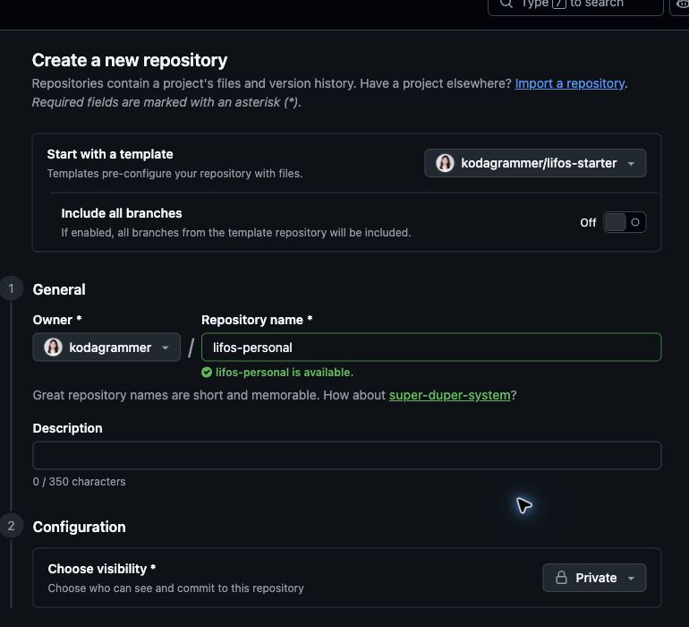
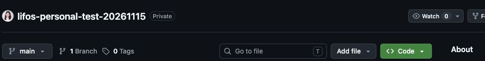
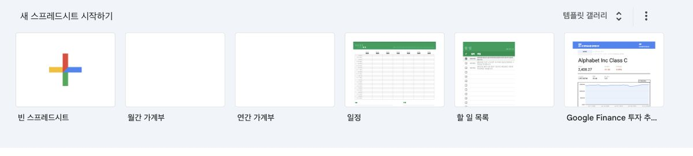
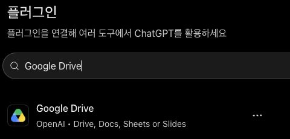
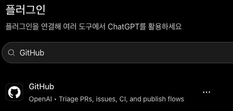
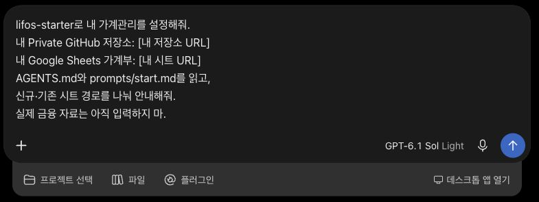
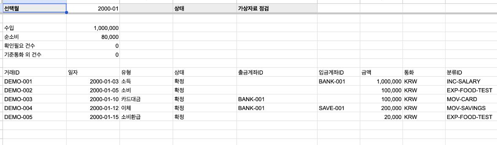

# 가입부터 개인 가계부 설정까지

각 단계의 완료 조건을 확인하고 다음으로 넘어가세요. 캡처는 2026-11-16 기준의 예시입니다. 저장소 이름·색상·버튼 위치가 달라도 **버튼 이름과 완료 조건**을 기준으로 진행하세요.

순서: **GitHub 가입 → Private 사본 → Google Sheets 준비 → AI 연결 → 시작 요청 → 가상 검증 → 첫 기록**.

이미지 파일은 모두 [assets/screenshots](../assets/screenshots/README.md)에 모아두었습니다. 예시의 샘플 저장소 이름을 따라 입력하지 말고 본인의 이름을 사용하세요. 처음에는 PC에서 진행하는 것이 편합니다. 서비스 화면이 달라지면 버튼 이름으로 찾아보세요.

## 1. GitHub 가입

1. [GitHub 가입](https://github.com/signup)을 엽니다.
2. 이메일·비밀번호·사용자 이름을 정하고 화면의 이메일 인증을 완료합니다.
3. 처음에는 무료 개인 계정으로 시작합니다. 선택적 유료 기능을 켤 필요는 없습니다.

완료: 로그인 후 오른쪽 위에서 내 계정을 확인할 수 있습니다.

## 2. 개인 비공개 저장소 만들기

1. [공개 lifos-starter 저장소](https://github.com/kodagrammer/lifos-starter)를 엽니다. 로그인하지 않으면 먼저 **Sign in**을 누릅니다.
2. 파일 목록 위의 **Use this template → Create a new repository**를 누릅니다.
3. **Owner**에서 내 계정을 선택합니다.
4. **Repository name**에 `lifos-personal`을 입력합니다. 이미 같은 이름이 있으면 다른 이름을 사용해도 됩니다.
5. 공개 범위를 **Private**로 선택합니다. 다른 branch 포함은 선택하지 않습니다.
6. **Create repository from template**을 누릅니다.
7. 새 화면의 소유자가 내 계정이고 이름 옆에 **Private**가 있는지 확인합니다.
8. 브라우저 주소를 복사해둡니다. 이것이 시작 요청에 넣을 개인 GitHub URL입니다.

**화면 A — 공개 원본에서 Use this template을 누르고 Create a new repository를 선택합니다.**



**화면 B — 이름을 정하고 Private를 선택한 뒤 생성합니다. Public 상태로 생성하지 않습니다.**



**화면 C — 생성 후 저장소 이름 옆 Private 표시를 확인합니다. 캡처의 이름은 검증용 예시입니다.**



완료: 내 비공개 저장소에 README.md, AGENTS.md, prompts 폴더가 있습니다.

`Use this template`이 없으면 배포자에게 Template repository 설정을 요청하세요. `Fork`로 대신 만들지 않습니다. 다운로드 파일을 받은 경우 [배포자 안내의 템플릿 없는 복사 방법](publishing.md)을 이용할 수 있습니다.

## 3. Google 계정과 가계부 준비

1. [Google 계정](https://accounts.google.com/signup)이 없으면 만듭니다. 이미 Gmail 등을 쓰고 있으면 같은 계정으로 로그인합니다.
2. 기존 가계부가 있으면 그 파일을 엽니다. 없다면 [Google Sheets](https://sheets.google.com)에서 **빈 스프레드시트**를 선택합니다.
3. 신규 파일만 제목을 `내 가계부`로 바꿉니다. 기존 파일 이름은 유지합니다.
4. 오른쪽 위 **공유**를 눌러 **일반 액세스: 제한됨**을 확인합니다.
5. 브라우저 주소를 복사합니다. 이것이 개인 가계부 URL입니다.

**화면 D — 신규 사용자만 빈 스프레드시트를 누릅니다. 기존 가계부가 있으면 새 파일을 만들 필요가 없습니다.**



**화면 E — 공유 창의 일반 액세스가 제한됨인지 확인합니다. 다른 사용자나 전체 공개로 바꾸지 않습니다.**


완료: 내 계정이 접근할 수 있는 신규 또는 기존 가계부가 있고 링크를 아는 모든 사람에게 공개되어 있지 않습니다.

## 4. AI에 GitHub와 Google Drive 연결

이 안내의 AI 경로는 ChatGPT/Codex의 플러그인 지원 화면을 기준으로 합니다. 메뉴·이용 가능 기능은 계정과 버전에 따라 다를 수 있습니다. 별도 API 키나 터미널 작업은 기본 절차에 포함하지 않습니다.

1. 사용하는 ChatGPT/Codex 화면에서 **Plugins(플러그인)**을 엽니다. 보이지 않으면 설정 메뉴에서 찾습니다.
2. **GitHub**를 검색해 설치하고 화면에서 GitHub 계정을 연결합니다. 저장소 선택을 요구하면 방금 만든 개인 저장소를 허용합니다.
3. **Google Drive**를 검색해 설치하고 가계부를 만든 Google 계정을 연결합니다. Sheets는 이 연결로 사용합니다.
4. 권한 안내를 읽고 진행합니다. 공유 설정을 ‘링크가 있는 모든 사용자’로 바꾸는 것은 연결의 대체 방법이 아닙니다.
5. 연결 관리 화면에서 **가계부를 만든 계정과 Google Drive 연결 계정이 같은지** 확인합니다. 다르면 올바른 계정으로 연결합니다. Sheets를 공개로 바꾸는 방식으로 해결하지 않습니다.
6. 새 대화를 열고 아래 확인 요청을 보냅니다. 주소 두 곳은 내 것으로 바꿉니다.

**화면 F — 플러그인에서 Google Drive를 검색합니다. 제공자가 OpenAI인지 확인하고, 처음이면 설치·연결을 진행합니다.**



**화면 G — Google Drive는 Sheets도 포함합니다. 설치 후 관리 화면에서 Google Sheets 기능과 연결 계정을 확인합니다. 캡처에는 계정 이메일을 포함하지 않았습니다.**


**화면 H — GitHub도 설치·연결합니다. 저장소 선택 화면이 나오면 새 Private 사본을 포함합니다. 이미 설치된 화면에는 관리 또는 채팅에서 사용해 보기 버튼이 보일 수 있습니다.**



캡처는 이미 플러그인이 설치된 ChatGPT 웹 화면입니다. 신규 계정의 설치 버튼이나 Codex 앱 메뉴 배치는 다를 수 있습니다. 권한 승인 화면은 본인 계정에서 직접 검토하며, 예시를 맞추려고 기존 연결을 해제하거나 권한을 확대하지 않습니다.

```text
내 GitHub 저장소: [개인 저장소 URL]
내 가계부: [Google Sheets URL]
GitHub의 README.md와 AGENTS.md를 실제로 읽고,
가계부의 현재 탭 이름을 실제로 조회해줘.
GitHub 파일 수정·저장과 Google Sheets 셀 수정이 가능한 도구가 있는지도
읽기 권한과 구분해서 알려줘. 아직 실제 거래는 쓰지 마.
```

완료: AI가 실제 파일 내용과 탭 이름을 답하고, 읽기·쓰기 가능 여부를 구분합니다. “연결되었을 것”이라는 답만으로는 완료가 아닙니다. 실제 쓰기는 다음 단계의 가상 연습으로 확인합니다.

**쓰기 기능이 없는 경우:** 같은 GitHub·Google Sheets 구성을 유지하면서 [수동 적용 경로](troubleshooting.md)로 진행할 수 있습니다. AI가 내용을 만들어주고 내가 GitHub 파일과 Sheets 셀에 적용합니다. 자동 기록이 필요하면 사용 가능한 쓰기 도구를 연결한 뒤 다시 확인합니다.

## 5. 시작 요청 보내기

[README의 시작 요청](../README.md)을 새 대화에 붙여넣고 URL 두 곳을 채웁니다. GitHub URL은 공개 원본이 아닌 **내 Private 사본**, Sheets URL은 **내 가계부** 주소입니다. 비밀번호·인증번호·전체 계좌번호는 입력하지 않습니다.

**화면 I — 입력창에 시작 요청을 붙이고 두 URL 입력칸을 본인 주소로 바꿉니다. 캡처는 입력 위치를 보여주는 짧은 예시이며, 실제 요청은 README의 전체 문장을 복사합니다.**



보낼 때는 화면의 보내기 버튼을 사용합니다. 줄바꿈을 넣으려면 Shift+Enter를 사용하거나 문장 전체를 붙여넣습니다. AI는 [전체 시작 절차](../prompts/start.md)에 따라 다음을 진행합니다.

1. 이미 설정된 것이 있는지 확인하고 신규·기존 경로 선택.
2. 신규는 별도 가상 연습 후 추천 계좌·계층 분류·빈 운영 원장 구성.
3. 기존은 원본을 읽기 전용으로 진단하고 [현재 구조에 맞는 운영지침](existing-sheet.md)과 필요한 최소 보완안 제안.
4. 기존 시트는 선택한 범위를 복사본에서 검증하고, 원본 변경이 필요하면 확인한 범위만 반영.
5. 개인 GitHub에 시트 위치·초기 설정 상태·개인 시트 운영지침 저장.

**화면 J — 가상 연습 결과의 예시입니다. 수입 1,000,000원·순소비 80,000원을 확인하고, 가상 거래가 실제 운영 원장에 섞이지 않았는지 확인합니다.**



완료: 선택한 경로의 검증이 끝나고 지원 기능과 제약을 알고 있습니다. 신규 운영 원장은 비어 있고 기존 운영 자료는 보존됩니다. 추천 7개 탭·기본 분류는 기존 사용자에게 강제하지 않습니다.

## 6. 첫 실제 기록

1. 실제로 발생한 거래 한 건을 골라 날짜·내용·금액·수단을 알려줍니다.
2. AI의 확인 질문에 답합니다. 모르는 것은 미확인으로 남깁니다.
3. [거래 기록 요청](../prompts/record.md)으로 기록합니다.
4. Google Sheets에서 그 거래를 직접 확인합니다.
5. 새 대화를 열어 [이어가기 요청](../prompts/resume.md)을 보내고 같은 거래가 보이는지 확인합니다.

완료: 대화를 바꿔도 거래와 개인 설정을 다시 읽을 수 있습니다. 최초 설정 성공과 한 달 지속 사용 성공은 따로 평가합니다.

## 참고한 공식 안내

- [GitHub 템플릿 복제](https://docs.github.com/en/repositories/creating-and-managing-repositories/creating-a-repository-from-a-template)
- [ChatGPT/Codex 플러그인 설치·연결](https://learn.chatgpt.com/docs/plugins)
- [Google 스프레드시트 공유·보호](https://support.google.com/docs/answer/9331169?hl=ko)

절차·캡처 확인 기준일: 2026-11-16. 계정별 서비스 이용 가능 여부와 쓰기 기능은 설치 후 직접 확인합니다.
